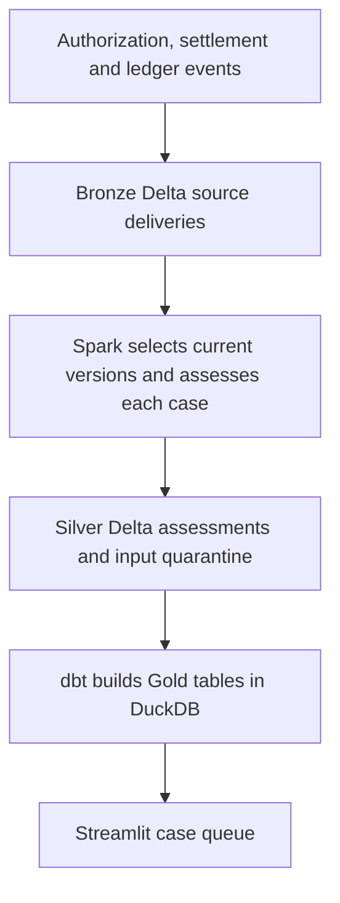
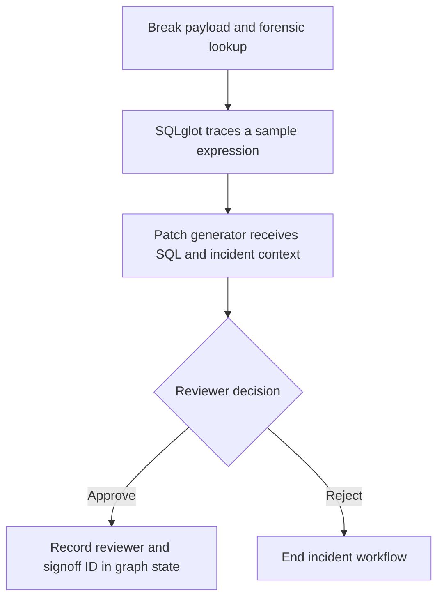

# AegisLake architecture

## Payment replay

The current demo follows a single synthetic card authorization across settlement and ledger systems. Source payloads are preserved in Bronze Delta. Validation isolates malformed inputs and conflicting versions. Spark reads eligible current versions and joins all three sources on the case identifier. Silver retains the independent amounts, source event IDs, missing legs and triggered rules.

dbt reads current Delta snapshots and builds DuckDB dimensions and facts. Authorizations and dimensions use the shared fixture registry. The Streamlit case queue, match-rate denominator and quarantine view read the generated warehouse. The runner checks independently authored expected outcomes when supplied.

The optional file-ingestion path uses a persistent Spark checkpoint and Bronze table. Silver and Gold run into a new directory for each assessment. Preserve successive output directories to inspect the previous and current case state. This local fixture runner materializes delivery records on the driver. Measure that path as a whole when reporting a local benchmark.

See the [card reconciliation contract](docs/card-reconciliation.md) for money and version semantics.

The release replay reads file deliveries with a persistent checkpoint and builds Gold from active Delta snapshots. The [broker producer](src/aegis_streaming/producer.py), [watermark helper](src/aegis_lakehouse/silver.py) and [CDF reader](src/aegis_lakehouse/delta_optimization.py) are separate integration components.

## SQL incident prototype

SQLglot follows column references in the [query supplied by the graph](src/aegis_agent/graph.py). That query illustrates tracing `discrepancy_amount_scaled` to `raw_amount * 100`. The graph sets the suspected source and affected models for this particular example. The [release's dbt model](aegis_dbt/models/staging/stg_silver_authorizations.sql) reads `amount_minor` directly.

The forensic lookup reads DuckDB. Quarantine and dry-run success in this incident graph are prototype state fields. A real quarantine table is built by the separate payment pipeline for malformed inputs. The [fallback proposal](src/aegis_agent/tools/llm_remediation.py) multiplies by one, so it demonstrates the review flow without correcting a value. The approval branch ends after recording a decision with LangGraph's in-memory checkpointer.

The [earlier Streamlit prototype](https://github.com/HetAshar13/AegisLake/blob/597711f2bf476c85ad85ceb2f9edcf00f68a9744/src/aegis_ui/app.py#L424) showed the draft and the approval buttons.
