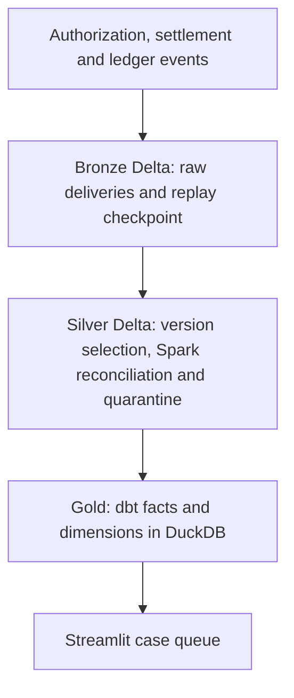

# AegisLake

AegisLake is a local payment reconciliation lakehouse built with PySpark,
Delta Lake, dbt and DuckDB. It replays corrections to source records and
demonstrates a human-reviewed repair for a broken dbt transformation.

[CI checks](https://github.com/HetAshar13/AegisLake/actions/workflows/ci.yml) · [Architecture](ARCHITECTURE.md) · [Payment contract](docs/card-reconciliation.md) · [Run the SQL repair](docs/sql-repair.md) · [Execution checkpoints](EXECUTION_STATE.md)



## The ledger is ten cents short

In the synthetic case `card_ledger_short`, both the authorization and settlement are €100.00. The ledger is the record that disagrees.

| Delivery | Ledger posting | Difference from settlement | Case status |
| --- | ---: | ---: | --- |
| Original | €99.90 | −10 cents | `BREAK_LEDGER_AMOUNT_MISMATCH` |
| Same events redelivered | €99.90 | −10 cents | `BREAK_LEDGER_AMOUNT_MISMATCH` |
| Higher-version ledger event | €100.00 | 0 cents | `MATCHED` |

The replay selects eligible event versions in Python on the driver. Spark
joins the three sources and compares amounts in integer minor units. The [replay verifier](scripts/verify_card_replay.py) restarts from a persistent file-stream checkpoint, checks that the duplicate changes nothing, and checks that the correction changes exactly one case. Each assessment has its own warehouse, so the original result remains inspectable.

## The SQL calculation looks wrong

In the [runnable repair demo](docs/sql-repair.md), a dbt model multiplies an amount that is already in cents by 100. A €100 payment becomes €10,000. SQLglot traces the bad calculation through the compiled model. A shadow build checks the proposed change against two synthetic rows. Approval rebuilds the demo model and stores the decision and verified result in a local SQLite receipt. Rejection closes the review. The proposal comes from a deterministic rule for this fixture.

With the dependencies installed, run this from the repository root. Choose a
fresh review directory each time.

```bash
export PYTHONPATH=src
review_dir=runs/sql-review
python -m aegis_agent.sql_repair_demo prepare "$review_dir"
```

Review the lineage, SQL diff and shadow output printed by `prepare`. If you
approve the proposal, run:

```bash
proposal=$(python -m aegis_agent.sql_repair_demo status "$review_dir" |
  python -c 'import json, sys; print(json.load(sys.stdin)["proposal_id"])')
python -m aegis_agent.sql_repair_demo approve "$review_dir" --reviewer "Het Ashar" --proposal "$proposal"
```

Receipt excerpt. Amounts are in minor units.

```json
{
  "status": "APPLIED",
  "before": [["card_eur", "EUR", 1000000], ["card_jpy", "JPY", 10000]],
  "shadow": [["card_eur", "EUR", 10000], ["card_jpy", "JPY", 10000]],
  "applied": [["card_eur", "EUR", 10000], ["card_jpy", "JPY", 10000]]
}
```

### Incident graph prototype

The incident prototype investigates a scaling expression in a sample SQL query. SQLglot parses the query and traces the output column `discrepancy_amount_scaled` through `raw_amount * 100` to `stg_silver_authorizations.raw_amount`. The graph passes the example table, column, expression and break payload to a patch generator. Gemini and Hugging Face are optional. The offline fallback supplies a placeholder proposal.

LangGraph pauses at the review step. Approval records the reviewer and a signoff ID in the graph’s in-memory state. Rejection ends the workflow. The [architecture notes](ARCHITECTURE.md#sql-incident-prototype) explain the prototype and its scope. The [graph tests](tests/test_agents.py) exercise both decisions.

## Run it locally

Use Python 3.12 and Java 17. Install the pinned dependencies from the repository root. The first build downloads Spark and DuckDB Delta dependencies.

```bash
python -m pip install -r requirements.txt
export PYTHONPATH=src
python scripts/run_card_demo.py --output runs/card-demo --expected fixtures/card_demo_expected.json
streamlit run src/aegis_ui/app.py
```

In PowerShell, use `$env:PYTHONPATH = "src"` in place of `export`. In Streamlit, select `card_ledger_short` in the case queue or append `?case=card_ledger_short` to the Streamlit URL. The denominator tab shows which cases contributed to the match rate.

To reproduce the original delivery, identical redelivery, and ledger correction, run `python scripts/verify_card_replay.py --output runs/card-replay`. The verifier checks that just one case changes and that the original assessments remain inspectable. Use a fresh output directory for each build. Set `AEGIS_WAREHOUSE` to a run’s `aegislake.duckdb` to open that run in Streamlit.

## What the pipeline verifies

1. Bronze Delta retains source deliveries, including malformed envelopes and duplicates. The pipeline validates event identity, timestamps, and amounts in integer minor units.
2. The runner selects the current version of each source leg on the driver.
   Spark joins the sources by authorization ID and builds the Silver
   assessments. Silver also stores quarantined input records. Amount
   comparisons require both source legs and a shared currency.
3. dbt reads the active Delta snapshot into DuckDB and builds Gold facts and dimensions. An expected-results fixture checks 11 case outcomes, including mismatches, missing legs, and an overdue settlement.
4. Streamlit reads Gold and quarantine in read-only mode and exposes breaks, source event IDs, and the match-rate denominator.

## Measured batch performance

| Synthetic reconciliation cases | Committed Bronze envelopes | Median wall time | Min–max |
| ---: | ---: | ---: | ---: |
| 1,000 | 2,455 | 19.18 s | 19.08–20.80 s |
| 10,000 | 24,548 | 21.07 s | 20.73–21.34 s |
| 100,000 | 245,455 | 30.29 s | 29.94–30.48 s |

Three measured batches per size on one GitHub-hosted Linux runner, after a warm-up. Each trial starts a new Python process and Spark JVM and uses warm dependency caches. The timer covers reading the fixture, Bronze and Silver Delta writes, the dbt Gold build and tests, and comparison with expected case outcomes. The raw envelope count includes redeliveries and quarantined inputs and was checked independently against the committed Delta snapshot. All nine trials passed the correctness checks.

[Benchmark job and logs](https://github.com/HetAshar13/AegisLake/actions/runs/44449326062) · [Benchmark JSON and Markdown](https://github.com/HetAshar13/AegisLake/actions/runs/44449326062/artifacts/14494249023) · [Benchmark and recording runner](scripts/card_release_evidence.py)

The replay covers synthetic, single-capture gross settlements. The [payment contract](docs/card-reconciliation.md) explains the posting convention, timing and event versions. Broker and cloud integrations are experimental.
