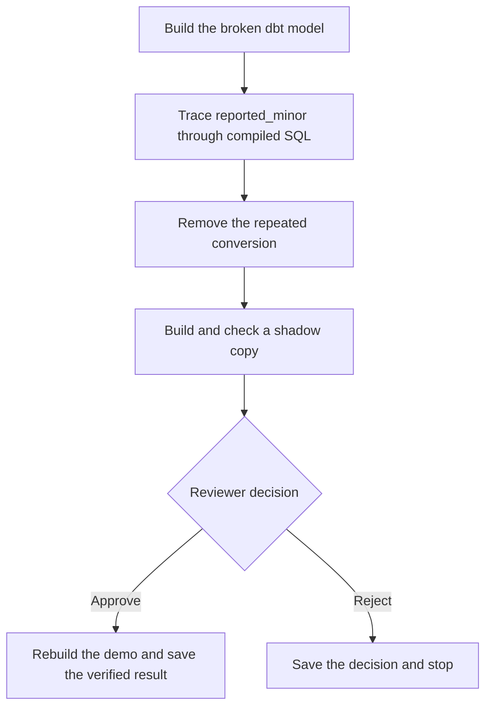

# Review a SQL repair

The demo starts with a dbt model that multiplies an already-normalized EUR amount by 100. The source reports 10,000 cents (€100). The broken model reports 1,000,000 cents (€10,000). A JPY payment acts as the comparison row.

| Fixture row | Before (minor units) | Shadow build | After approval |
| --- | ---: | ---: | ---: |
| EUR payment | 1,000,000 | 10,000 | 10,000 |
| JPY payment | 10,000 | 10,000 | 10,000 |



## Run the demo

From the repository root, use Python 3.12 and install the pinned [dependencies](../requirements.txt). This demo runs with the bundled dbt project and DuckDB. The proposal comes from a deterministic rule for this fixture.

```bash
export PYTHONPATH=src
python -m aegis_agent.sql_repair_demo prepare runs/sql-review
```

In PowerShell set `$env:PYTHONPATH = "src"`. Choose a fresh directory for every proposal. The command prints the column lineage from the compiled model, the SQL diff, the before and shadow rows, and the proposal ID.

For a change you accept, replace `PASTE_PROPOSAL_ID` with the printed value.

```bash
python -m aegis_agent.sql_repair_demo approve runs/sql-review --reviewer "Demo reviewer" --proposal PASTE_PROPOSAL_ID
python -m aegis_agent.sql_repair_demo status runs/sql-review
```

To try rejection, prepare a second directory and use `reject` with that directory and its proposal ID. The receipt records a rejection without an applied result.

## What the checks cover

- SQLglot traces `reported_minor` to `payment_input.amount_minor` in the SQL emitted by dbt. The change removes the repeated conversion from the disposable model.
- The shadow build must fix the EUR row and preserve the JPY row. The proposal ID binds the SQL and project files to the reviewed change.
- Approval runs dbt again in a fresh temporary project and checks both rows before committing the decision and rebuilt result to `review.sqlite`. A repeat approval by the same reviewer returns the first receipt. Rejection closes the review.
- The fixture, build and reviewer name are for a local demonstration. The receipt is a local record. The payment-replay warehouse is outside this demo.

[dbt model](../fixtures/sql_repair/models/payment_amounts.sql) · [Review workflow](../src/aegis_agent/sql_repair_demo.py) · [Tests](../tests/test_sql_repair_demo.py)
